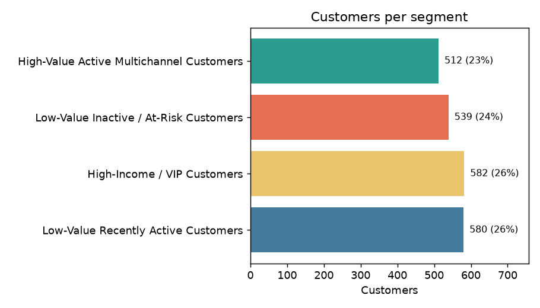
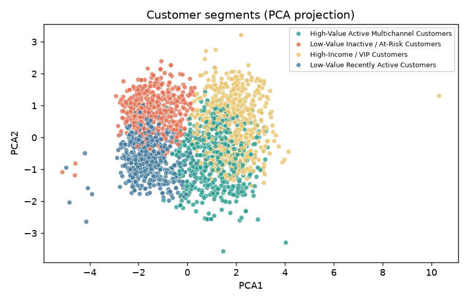
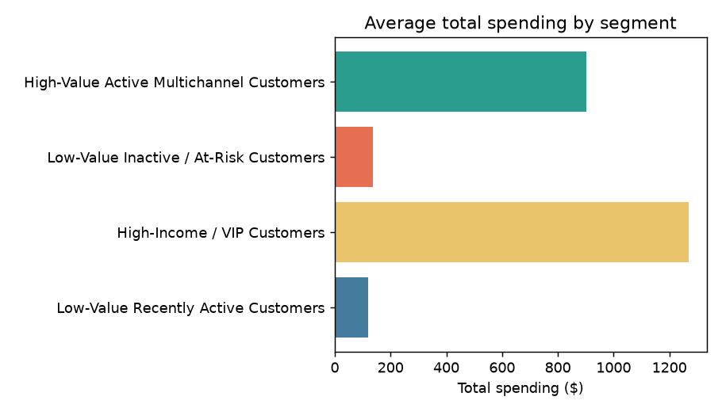
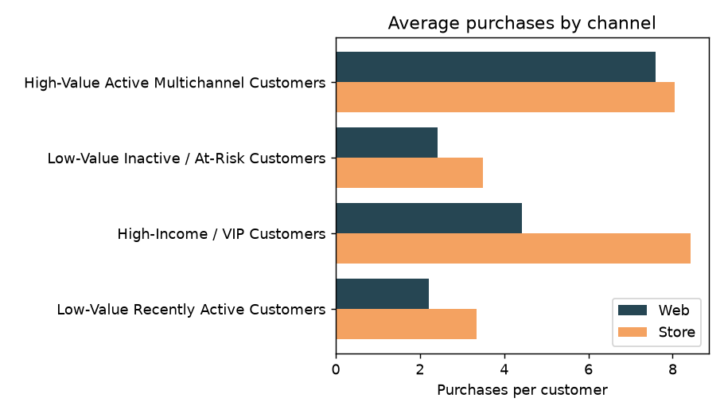
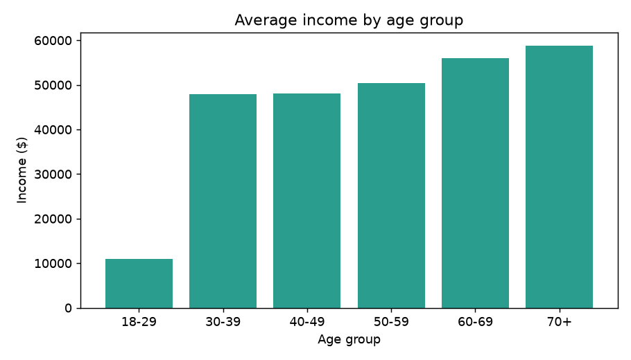
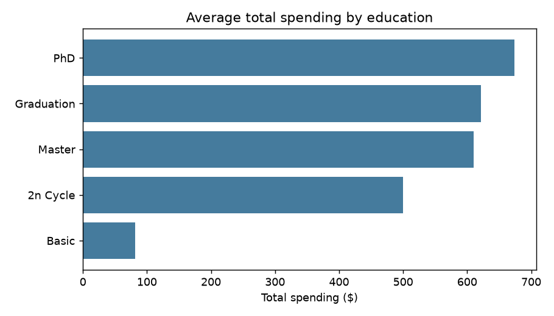
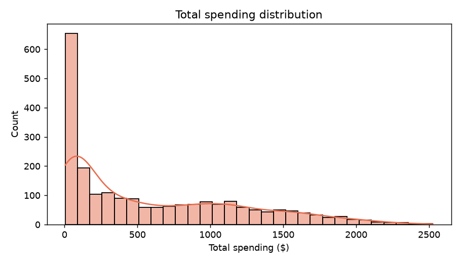
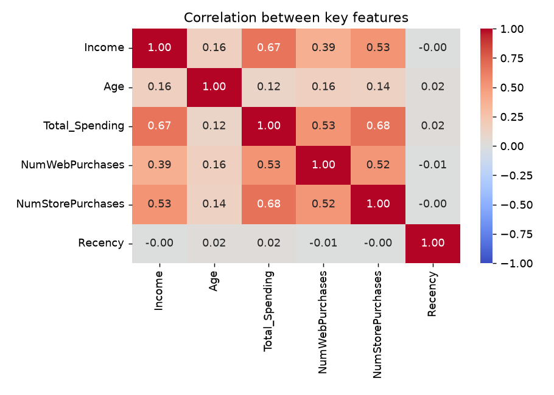

# Customer Segmentation (K-Means Clustering)

Machine-learning project that groups customers into four segments from their demographics, spending and purchase behaviour, and serves the result as a small Streamlit app: enter a customer's details and get their predicted segment.

## Dataset

`customer_segmentation.csv` holds 2,240 customers and 29 columns, including demographics (birth year, education, marital status, income, children at home), spending per product category, purchase channels (web, store, catalog), web visits, recency, and campaign responses.

## Approach

All of the analysis lives in [`Analysis_Model.ipynb`](Analysis_Model.ipynb):

1. **Cleaning and feature engineering** — `Age` is derived from the birth year (customers aged 100 or over are removed as outliers) and `Total_Spending` is the sum of the per-category spending columns.
2. **Exploratory analysis** — distributions of age and spending, spending by marital status and education, a correlation heatmap, and average income by age group.
3. **Segmentation** — seven features are standardized with `StandardScaler`:

   | Feature | Meaning |
   |---|---|
   | `Age` | Customer age |
   | `Income` | Annual income |
   | `Total_Spending` | Total spent across product categories |
   | `NumWebPurchases` | Purchases made on the website |
   | `NumStorePurchases` | Purchases made in store |
   | `NumWebVisitsMonth` | Website visits per month |
   | `Recency` | Days since the last purchase |

   The number of clusters is chosen with the elbow method (WCSS for k = 2 to 9), then a final `KMeans(n_clusters=4, random_state=42)` model is fitted. PCA to two components is used to visualize the clusters.
4. **Export** — the fitted model and scaler are saved with `joblib` as `kmeans_model.pkl` and `scaler.pkl`.

## Segments

| Cluster | Segment |
|---|---|
| 0 | High-Value Active Multichannel Customers |
| 1 | Low-Value Inactive / At-Risk Customers |
| 2 | High-Income / VIP Customers |
| 3 | Low-Value Recently Active Customers |

The names are fixed in `segmentation.py`. If you change the features, the number of clusters or the seed, check the cluster summary in the notebook and update the names to match.

## Streamlit app

`segmentation.py` is a two-page app. A button at the top right switches between the pages.

**Predictor** — a form for the seven features above; click **Predict Customer Segment** to see which segment the customer belongs to.

**Dashboard** — analysis of the whole customer base, with a segment filter at the top:

- KPI cards: customers, average income, total spending, recency and age
- Segmentation: customers per segment, a PCA scatter plot of the clusters, and a table with the average of each feature per segment
- Analysis: spending by segment, web vs. store purchases by segment, income by age group, spending by education, the spending distribution, and a correlation heatmap

The dashboard reads `customer_segmentation.csv`, applies the same cleaning as the notebook, and assigns each customer a segment with the saved model and scaler, so it always agrees with the predictor.

### Dashboard charts

**Segmentation**

| Customers per segment | Segments in PCA space |
|---|---|
|  |  |

**Analysis**

| Spending by segment | Purchases by channel |
|---|---|
|  |  |

| Income by age group | Spending by education |
|---|---|
|  |  |

| Spending distribution | Feature correlations |
|---|---|
|  |  |

## Run with Docker (recommended)

The only requirement is [Docker](https://docs.docker.com/get-docker/) (Docker Desktop on Windows and macOS). It works the same on Windows, macOS, Linux and Apple Silicon.

```bash
git clone https://github.com/youssefamr4800/Customer_Segmentation.git
cd Customer_Segmentation
docker compose up -d --build
```

Then open <http://localhost:8501>.

The model files are git-ignored, so the Docker build creates them: a first build stage runs `Analysis_Model.ipynb` headlessly to train the model and scaler, and a second, slim stage copies them in with the app. The first build takes a few minutes; later starts are instant. The container restarts automatically after a crash or reboot.

Useful commands:

```bash
docker compose logs -f      # follow the logs
docker compose down         # stop and remove the container
docker compose up -d --build  # rebuild after changing the notebook or data
```

If you add a library to the notebook, add it to `requirements.txt` too, otherwise the build will stop at the notebook step.

## Run without Docker

Requires Python 3.12.

```bash
python -m venv .venv
source .venv/bin/activate        # Windows: .venv\Scripts\activate
pip install -r requirements.txt
pip install jupyter              # only needed to run the notebook

# 1. Generate kmeans_model.pkl and scaler.pkl
jupyter nbconvert --to notebook --execute Analysis_Model.ipynb --inplace
#    (or open the notebook and run all cells)

# 2. Start the app
streamlit run segmentation.py
```

## Project structure

```
.
├── Analysis_Model.ipynb       # EDA, clustering and model export
├── customer_segmentation.csv  # Dataset
├── segmentation.py            # Streamlit app (predictor + dashboard)
├── charts/                    # Dashboard chart images used in this README
├── requirements.txt           # Pinned Python dependencies
├── Dockerfile                 # Two-stage build: train model, then run app
├── docker-compose.yml         # One-command run on port 8501
└── .dockerignore
```

## Tech stack

Python, pandas, NumPy, scikit-learn, matplotlib, seaborn, Streamlit, joblib, Docker.
